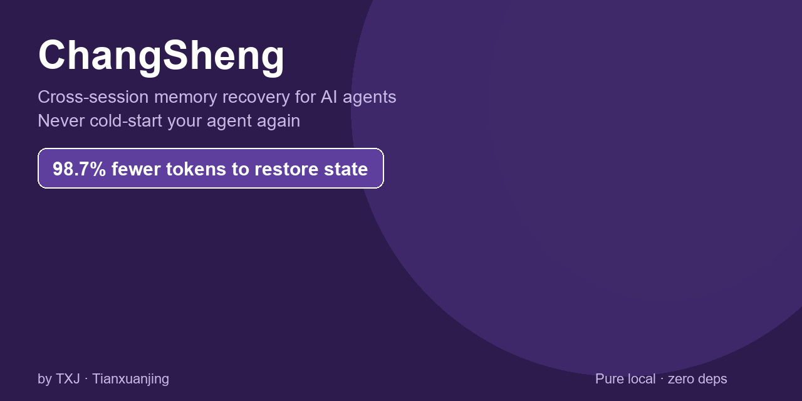
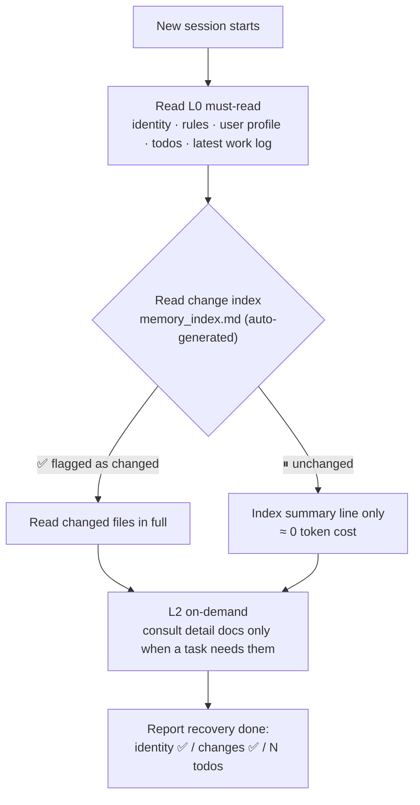

# ChangSheng

<p align="center">
  
</p>

**Your agent's memory, decoupled from the model.** Switch models mid-project — DeepSeek today, MiniMax tomorrow, a local 27B next month — and your agent still knows who you are, what the rules are, and where work left off. Recovery reads **8,669 tokens** per session. A naive full restore of all sixteen memory systems would cost **685,560** — the tiered read is **1.3% of a naive full restore, 98.7% less**.

[](https://github.com/ccy123abcd/changsheng-agent-memory/tags)


Every new session feels like "day one at work"? Your agent doesn't know who you are, what the rules are, or where work left off — so you re-explain everything, and it still drops things.

ChangSheng hands your agent a **shift handover** before it starts working:

- **Always reads** the core layer — identity, rules, user profile, latest todos, latest work log (nothing important silently dropped)
- **Re-states your rules** every session (rules alignment) — the do's and don'ts you set stay loaded, and stay followed
- **Checks a change index** (auto-generated, hash-based) before re-reading secondary files — unchanged files cost ~0
- **Keeps a review ledger** — every always-read file carries a byte budget, a review date and an expiry action, so a stale rule is flagged instead of quoted as current
- **Finds the reason behind a decision** — one command searches todos, logs, notes and the archive for *why* something was decided, not just where a word appears
- **Defers everything else** until it is actually needed
- **One-line handover** — say "handover" at a task break; the next session picks up exactly there

**This release publishes the design, not just the scripts.** The method behind
ChangSheng — four layers, whose/when tagging, entry points with checks, budget
rules — is in [`references/memory-system.md`](references/memory-system.md). Copy
the shape into your own setup, with any file layout and any tool.

Measured on our own production system (on-disk, 2026-10-24): a session recovers in **8,669 tokens**. A naive full restore of all sixteen systems would cost **685,560 tokens** — **1.3% of that, 98.7% less**. Host-injected identity (e.g. Hermes) is counted separately (37,630 B) and never double-read.

### Why this changes your workflow: free context switches

Cheap, reliable recovery turns "start a new session" from a **lossy, expensive operation** into a **free, safe one**. You no longer have to stretch one session until the context breaks — you switch whenever it makes sense:

- task boundary reached? **Switch.** A fresh, clean context works better than a bloated one
- long-running project? **Switch at milestones** — each session resumes exactly where the last one left off
- context getting heavy? **Switch early** instead of waiting for compression to kick in

Every switch costs a few thousand tokens to recover instead of tens of thousands of re-explaining — so the optimal move shifts from "squeeze one session dry" to "cut at the cleanest seam". This is the pattern we run in production (dozens of sessions per day, cross-session handover as the default).

## Quick start

```bash
# 1. get the skill (clone straight into the skills dir — no rename needed)
git clone https://github.com/ccy123abcd/changsheng-agent-memory.git ~/.claude/skills/changsheng
cd ~/.claude/skills/changsheng

# 2. cold start (no config needed — discovery finds your layout)
python scripts/memory_index.py --list .   # optional: preview what discovery picks
python scripts/memory_index.py            # discover + write index (≈30s total)

# 3. (optional) tune — copy config.example.yaml → config.yaml (mode/roles/extras),
#    or edit .changsheng/discovery.json to override a discovered role

# 4. self-test
python scripts/memory_index.py --demo
```

> Windows (PowerShell): use `$HOME\.claude\skills\changsheng` instead of `~/.claude/skills/changsheng`.

### Make it automatic (3 lines, 3 platforms)

Paste the block in [`assets/agents-snippet.md`](assets/agents-snippet.md) into **your project's
instruction file** — `AGENTS.md` (or `.hermes.md` on Hermes if you use one). Hermes, OpenClaw and
DeepSeek Harness all load that file at session start, so recovery then runs by itself: no code, no
hooks, no config. No instruction file in your project? Then just say "recover memory" per session.

## Platform support

| Platform | How to use |
|---|---|
| **Hermes** (Nous Research) | Drop into the agent's `skills/` directory, then paste `assets/agents-snippet.md` into `.hermes.md` or `AGENTS.md` → recovery runs automatically. Hermes injects SOUL/MEMORY/USER itself, and the skill detects host-injected identity and skips duplicate reads (the host-injected case). |
| **ClawHub / OpenClaw** | Dual-compatible frontmatter (standard + `metadata.hermes`). Install into the skills directory or via your hub client. |
| **WorkBuddy** | In the WorkBuddy skill market, search “ChangSheng Memory” → tap + to install → say “recover memory” in a chat. Scripts run via Bash; state files live under the skill directory's `.changsheng/`. No Obsidian needed — any Markdown folder works. See SKILL.md for the WorkBuddy subsection (host-injected identity, no context gauge, user-approved search roots only). |
| **Claude Code / Cursor / Codex** | Copy the folder into the project or agent skills directory (`~/.claude/skills/`, etc.); instruct the agent to follow SKILL.md at session start. |
| **Any LLM, any OS** | Recovery logic is pure convention + one Python stdlib script — model-agnostic; Windows / macOS / Linux; no GPU. |

## Why not just another memory plugin?

Existing memory/marketplace skills are mostly about **storing** memories. Nobody solves **cheap, reliable recovery**:

- Naive recovery = re-read everything → 685,560 tokens per session; tiered recovery is 8,669
- "Trust the model to remember" = gamble → it forgets, and you don't know what it forgot

The missing piece is a **change index**: a daily hash pass that tells the agent *what actually changed* since the last session. With it, recovery is **neither expensive nor risky**. That index is what this skill automates (`scripts/memory_index.py`, pure stdlib, ~0 cost).

## Why is this free?
ChangSheng is the memory layer of the [Tianxuanjing agent system](https://aivaultpro.com) — a dozen-plus agents, dozens of sessions a day, in real production use. We open-sourced the method (MIT-0) because a memory system gets better the more people run it, and because we'd rather earn your trust than your license fee.

There's no upsell inside the skill. Same memory, zero re-setup when you switch models.

## How it works



| Layer | Reads | When | Cost |
|---|---|---|---|
| **L0 Must-read** | identity / rules / user profile / latest todos / latest work log | Every new session — reliability anchor | small & fixed |
| **L1 Conditional** | secondary files (roles, members, configs) | **Only if the auto-generated index flags a change**; otherwise just the index summary line | ≈0 ← savings live here |
| **L2 On-demand** | detail docs / history | Only when actually needed | 0 |
| **L3 Fallback** | whole corpus — keyword / full-text search | When the first three tiers miss | budgeted, with a timeout |

`scripts/memory_index.py` hashes every L1-tracked file (md5 + 24h freshness window) and writes a human-readable `memory_index.md`. No index → all-or-nothing. With an index → read the few files that changed.

> **Honest numbers** (measured on the author's own production setup, on disk, 2026-10-24)
>
> - Tiered recovery: **8,669 tokens** per session
> - Naive baseline (read every file of all sixteen memory systems): **685,560 tokens**
> - Ratio: **1.3%** (98.7% fewer tokens)
> - Token counting: TODO — the repo does not yet record which tokenizer or estimation method produced these figures; do not cite them as tokenizer-exact until this is filled in.
> - Host-injected identity (e.g. Hermes, 37,630 B) is counted separately and never double-read; whether it is included in both figures above is TODO — confirm before citing the ratio as all-in.
> - The ~46 MB of raw material in the store is not on the restore path and is counted in neither figure.
> - Reproduce: TODO — no one-command reproduction is recorded in the repo yet.
>
> This measures **token cost only**. See "Recovery quality check" below for whether the skipped content matters.
>
> Highest-value users: heavy multi-session automation (many sessions/day).

## Recovery quality check

Questions the agent must answer correctly right after recovery. Same questions, two recovery modes. Not yet measured — fill in before citing any quality claim.

| # | Question | Naive full restore | Tiered (ChangSheng) |
|---|---|---|---|
| 1 | Who is the user and what is their role? | TODO | TODO |
| 2 | What are the three hard rules set for this project? | TODO | TODO |
| 3 | What were the open todos at the end of last session? | TODO | TODO |
| 4 | Why was decision X made? | TODO | TODO |
| 5 | What file changed since the last session? | TODO | TODO |

Pass rate: naive TODO/N, tiered TODO/N. Run date: TODO.

## Memory that never gets lost, three ways

Introduced in 0.99.0, still in 1.0.2:

- **Memory ledger** (`scripts/memory_ledger.py`) — every long-lived memory carries four fields: why it exists, when it's reviewed, how long it lives, what happens at expiry. Hard budget cap (30 KB). Nothing rots silently; the check reports missing files, missing fields, overdue reviews, expired entries, and over-budget ledgers.
- **Provenance recall** (`scripts/recall.py`) — "why did we decide this?" answered in seconds, with file names and line numbers, across todos, logs, notes/decisions, and archives. Every surface reports even on zero hits (silence is never confused with not searched); all-four-empty is its own exit code, never confused with "didn't look."
- **The method, written down** (`references/memory-system.md`) — the full system: one home per fact, two orthogonal questions (whose × which time direction), an entry table for every event type, budget rules, honest-reporting discipline — and a section on what this method does *not* solve.

## Configuration (optional)

ChangSheng works with **no config** (auto-discovery). To tune, copy `config.example.yaml` → `config.yaml`:

- `mode` — `auto` (default, discovers your layout) / `manual` (explicit paths only) / `internal` (fixed-layout)
- `roles` — semantic roles → real files: `rules` / `identity` / `todos` / `journal` / `profile` (file or directory; a directory resolves to its newest `YYYY-MM-DD.*` file)
- `must_read_extra` — extra L0 files read in full every session
- `tracked_files_extra` — extra L1 files, change-tracked (path / display name / description)

Legacy 0.2.x `must_read`/`tracked_files` keys migrate automatically (kept as L0/L1 extras). Discovery output lives in `.changsheng/discovery.json` — override any role there.

Outputs: `memory_index.md` (readable) + `memory_index_state.json` (state — don't hand-edit).

## Usage protocol (start of every new session)

0. **Discover** — read `.changsheng/discovery.json` (or run `python scripts/memory_index.py --discover .` on first use); stat the stored paths — any missing source triggers re-discovery. Python unavailable? Use the manual fallback list in SKILL.md.
1. Read the L0 roles + `must_read_extra` — every one, no shortcuts (host-injected identity = skip the file probe).
2. Read `memory_index.md`:
   - ✅ new change → read that file in full
   - ⏸ unchanged → index summary line only
3. Consult L2 detail docs only when a task needs them.
4. **Rules alignment** — from the rules file just read, restate the imperative rules (do / don't) and write `.changsheng/rules.json` for the guardrail. Optional hard enforcement: wire `scripts/rule_gate.py` into a platform hook (Claude Code PreToolUse example in SKILL.md).
5. Report honestly with sources — list any role that came up empty; never claim a recovery that didn't happen.
6. Context gauge — report real usage % when the platform exposes it (Hermes `/status`, Claude Code `/context`); check at every visible reading, nudge when approaching a band (25–30 / 45–50 / 65–70 by default) as well as inside it, and **refresh `.changsheng/handover.md` before any nudge goes out** — the nudge is the ready signal (full band table in SKILL.md; **tune the lines via `nudge_thresholds` in config.yaml**, e.g. 30/50/70 → 35/55/75 for more headroom).
7. Handover — at any task break say **"handover"**: the agent writes `.changsheng/handover.md` from the template; the next session reads it first.

## Repository layout

```
changsheng-agent-memory/     # install as ~/.claude/skills/changsheng/
├── SKILL.md                 # agent-facing instructions (progressive disclosure)
├── README.md                # this file
├── config.example.yaml      # configuration template
├── scripts/
│   ├── memory_index.py      # change-index generator (pure stdlib, zero deps)
│   ├── memory_ledger.py     # must-read budget + review ledger (pure stdlib)
│   ├── recall.py            # "why did we decide this?" search across four surfaces
│   └── rule_gate.py         # optional action-time guardrail (reads .changsheng/rules.json)
├── references/
│   └── memory-system.md     # the method: four layers, whose/when tags, entry points, budget rules
├── assets/
│   ├── agents-snippet.md    # paste-in block for AGENTS.md / .hermes.md
│   ├── banner.png           # README banner
│   └── handover-template.md # handover note template
├── tests/
│   └── test_scripts.py      # script self-tests (unittest)
├── CHANGELOG.md
├── LICENSE                  # MIT-0
└── version
```

### The two new doors (introduced in 0.99.0)

```bash
# ledger — the must-read layer as a budget with expiry
python scripts/memory_ledger.py --init     # build .changsheng/ledger.json from what was discovered
python scripts/memory_ledger.py --check    # missing files · incomplete rows · overdue reviews · stale rows · over budget
#   each row: why · review_by · max_age_days · action_on_expiry
#   hard byte budget 30000 (target 25000) — adding a row means naming a row that leaves

# recall — the reason behind a decision, across four surfaces
python scripts/recall.py "why we chose SQLite"
python scripts/recall.py handover --paths notes journal
#   surfaces: todos · journal · notes · archive; every surface is reported even with zero hits
#   exit 3 = nothing could be searched at all (never confused with "not found")
```

Both are pure stdlib, zero dependencies, offline. The ledger writes only its
own JSON file; recall writes nothing at all.

## Security

- Discovery scans candidate paths by name only (metadata — no content); the index reads and hashes only files you listed (roles + extras). Never writes your memory files themselves — its own outputs are `.changsheng/discovery.json`, index md + state json, plus three optional agent-maintained files: `.changsheng/ledger.json` (your review table), `.changsheng/rules.json` (extracted rules for the optional gate) and `.changsheng/handover.md` (one-shot handover note, deleted after being read)
- `recall.py` reads text files under the directories you point it at and prints matching lines back to you — it writes nothing and sends nothing
- Nothing leaves your machine — no remote install pipelines, no script-to-shell execution
- Python standard library only. PyYAML optional: when absent, a built-in fallback parser reads the config (nested `roles:`, extras, flat `role_*` keys) — no silent config loss

## FAQ

**Why do I keep getting nudged to start a new session?**
Context windows fill up as a conversation grows — replies slow down, early instructions get squeezed, and quality drops. ChangSheng's nudges (default lines at 30/50/70%) remind you *before* that happens, and every nudge is preceded by a refreshed `.changsheng/handover.md`, so switching loses nothing. Recovery after a switch costs about 8,700 tokens instead of tens of thousands of re-explaining.

**Can I change when I get nudged? Yes.**
Copy `config.example.yaml` → `config.yaml` and set `nudge_thresholds` to your own lines, e.g. `[35, 55, 75]` if you prefer more headroom before being reminded. The agent reads it at recovery and uses your lines instead of the defaults. (No config file? The 30/50/70 defaults apply.)

**A nudge said "Handover is ready" — do I have to do anything?**
No. The handover note was already written for you. Just start a new session (or say "handover" first if you want to add anything); the next session picks up exactly where you stopped.

**Does ChangSheng send my data anywhere?**
No. Everything is local — discovery is name-only, the index hashes files you listed, nothing is uploaded. See Security.

## Roadmap

- Auto user-profiling (preferences / habits)
- **0.99.0 — The design, published: `references/memory-system.md` (four layers, whose/when tags, entry points, budget rules) + `memory_ledger.py` (budget & expiry) + `recall.py` (reason-recall across four surfaces).**
- **1.1 = the write side closes the loop.** 1.0.x ships the read side (recovery) plus the method; 1.1 is when a memory also *enters* the system without you writing it down: capture (facts, decisions, preferences) happens as you work, the ledger's expiry actions actually run, and the archived layer is searchable across machines. Concrete bar for 1.1: (a) a write-side capture path with a documented entry point for every event type, (b) the ledger's `action_on_expiry` executed by a real runner rather than only reported, (c) cross-machine recall over the archive, (d) the recovery-cost measurement re-run on the 1.1 build and published as a number. Until those four hold, the write side stays half — periodic tidy-up, triggered by you.
- **0.6.0 — Dreaming (write side) + Chinese reachability lines** (2026-09-19)
- Cross-device sync + web console
- One-click deploy

## Going further

Also by the same team: **Mode Switch Kit** — one command flips your whole machine stack (VPN, background agents, local services, model tier) from a single YAML mode matrix.

## License

MIT-0 — free to use, modify, and sell.

---

*Crafted with ❤ by TXJ · Tianxuanjing*  

⭐ Found this useful? Star the repo — it helps others find it. Found a bug? [Open an issue](https://github.com/ccy123abcd/changsheng-agent-memory/issues).
